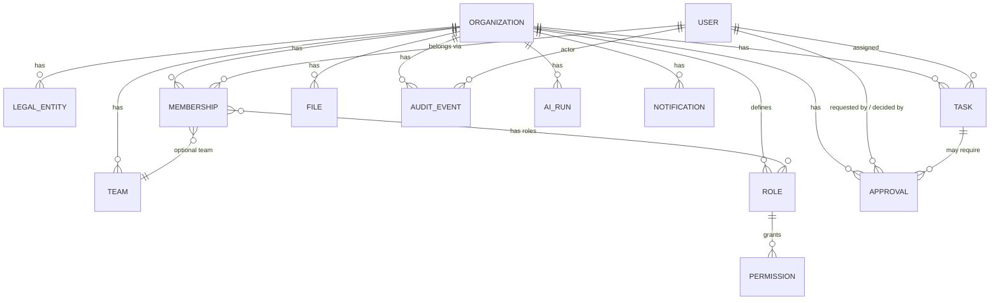
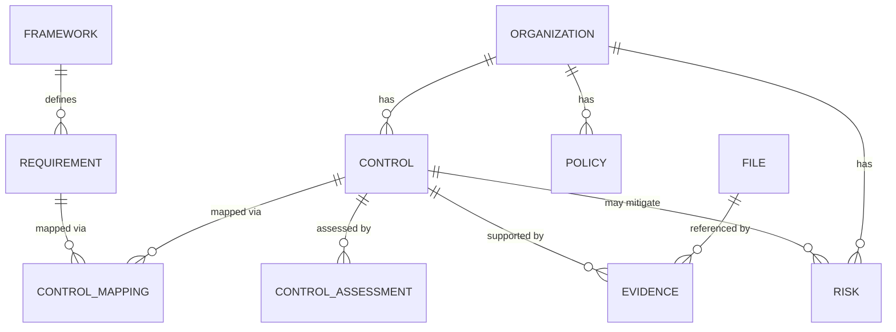
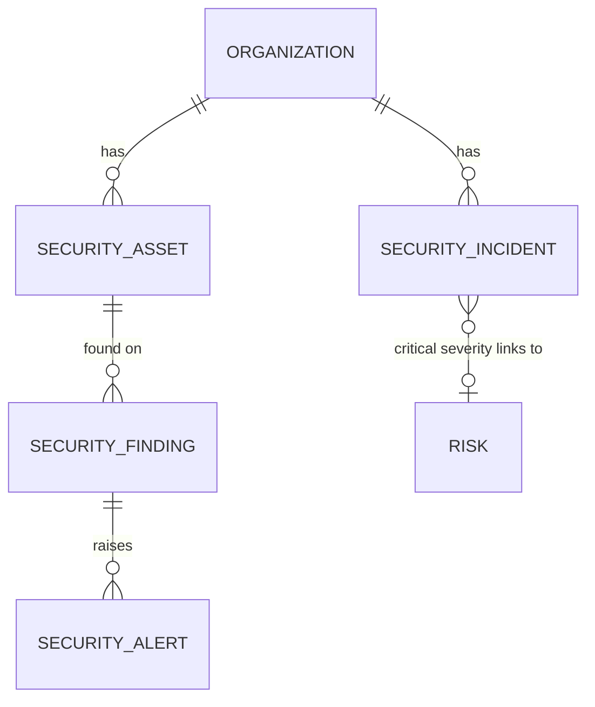

# Domain Model

Full target domain model across all modules is cataloged in the master spec
§50 (Data Model) and §10 (Organization Knowledge Graph). This document
defines the **shared platform primitives** that every module builds on
(spec §80) and marks which are implemented now vs. reserved for later
phases.

## Phase 1 entities (implemented)

- **Organization** — the tenant boundary. Everything tenant-scoped carries
  `organization_id`.
- **LegalEntity** — optional sub-division of an Organization (spec §53); a
  single default legal entity is created per org in Phase 1.
- **User** — a person; global identity, not tenant-scoped by itself.
- **Membership** — join of User ↔ Organization (+ optional Team), carries
  one or more Roles. This is the row RBAC and tenant-resolution both read.
- **Team** — optional grouping of memberships within an org.
- **Role / Permission** — Role is a named bundle of capability strings
  (`sales.leads.view`, `ai.actions.approve`, ... spec §54). Seeded system
  roles match the spec's default role list; organizations may add custom
  roles in a later phase.
- **Task** — cross-module unit of work (spec §44). Phase 1 ships the shared
  primitive; module-specific task types arrive with their modules.
- **Approval** — a pending decision gate tied to a risk-classified action
  (spec §B7, §45). Phase 1 ships the primitive and a generic approve/reject
  flow; module-specific approval triggers arrive with their modules.
- **AuditEvent** — append-only record of security-relevant activity
  (spec §B8, §56). Never updated or deleted by application code.
- **File** — uploaded object metadata; the object bytes live in S3/MinIO,
  referenced by a signed URL, never a raw key exposed as auth.
- **AiRun** — one call through the AI Model Gateway: task type, prompt
  version, model, input classification, output, citations, confidence,
  policy result (spec §F3, §56).
- **Notification** — in-app notification record; email/Slack/Teams dispatch
  channels are interfaces with a local/demo adapter in Phase 1.

## Reserved (not yet modeled — created with their owning phase)

| Domain | Key entities | Phase |
|---|---|---|
| Knowledge | ~~documents, document_chunks, knowledge_bases~~ (implemented — see below), entities, entity_relationships (not yet) | 2 |
| Compliance | ~~frameworks, requirements, controls, evidence, risks, policies~~ (implemented — see below), audits (not yet) | 3 |
| AI Governance | ai_systems, ai_assessments, ai_incidents | 3 |
| Privacy | processing_activities, dpias, dsars, data_transfers | 3 |
| Security | ~~security_assets, security_findings, security_alerts, security_incidents~~ (implemented — see below) | 4 |
| Sales | accounts, contacts, leads, sequences, opportunities | 5 |
| Support | customers, tickets, support_conversations, knowledge_articles | 6 |
| Automation | workflows, workflow_versions, workflow_runs | 7 |
| Integrations | integration_connections, webhooks, api_keys | 9 |
| Billing | subscriptions, entitlements | 10 |

## Phase 2 entities (implemented)

- **KnowledgeBase** — a named collection of documents per organization. A
  "General" one is created lazily the first time a document is uploaded
  without specifying which knowledge base it belongs to.
- **Document** — one uploaded `File` registered for ingestion. Status
  moves `pending → processing → ready` or `failed`/`unsupported_format`
  (spec §I4: honest states, never a fabricated "ready").
- **DocumentChunk** — one chunk of extracted text plus its embedding
  vector (stored as JSON — see `docs/DECISIONS.md` ADR-0007) and token
  count. This is the substrate the AI Copilot's RAG retrieval (not yet
  built) will query against.

Entity/relationship extraction (spec §11's knowledge graph) is not
implemented — chunks are stored flat, with no entity linking yet.
Retrieval and the AI Copilot (Phase 2's remaining scope at the time the
note above was written) are now implemented — see `docs/AI_ARCHITECTURE.md`.

## Phase 3 entities (implemented — Compliance backbone)

- **Framework / Requirement** — global catalog data (GDPR, EU AI Act, ISO
  27001 seeded; NIS2/DORA/SOC 2/custom frameworks follow the same pattern
  when needed), not tenant-scoped — regulatory text doesn't vary per
  organization, same reasoning as system Roles.
- **Control** — an organization's own implemented measure, optionally
  mapped to one or more catalog Requirements via **ControlMapping**.
- **ControlAssessment** — a point-in-time pass/fail/partial judgement. A
  `fail` assessment automatically creates a `core.Task` (spec §80's
  "shared primitives" principle in action, not a Compliance-specific
  follow-up mechanism).
- **Evidence** — reuses the Phase 1 **File** primitive rather than a
  parallel storage path; optionally attached to a Control.
- **Risk / Policy** — organization-scoped; a Risk may reference the
  Control that mitigates it.

Not modeled yet: framework/evidence versioning, audits (auditor portal),
AI governance (ai_systems/ai_assessments), privacy workflows (RoPA, DPIA,
DSAR), vendor risk, questionnaires, Trust Center — each a substantial
feature attaching to this backbone, not blocking it. See
`docs/KNOWN_LIMITATIONS.md`.

## Phase 4 entities (implemented — Security backbone)

- **SecurityAsset** — cloud accounts, servers, endpoints, repositories,
  etc. (spec §14's inventory). Tenant-scoped, unlike Compliance's
  Framework/Requirement — an organization's own infrastructure, not
  shared catalog data.
- **SecurityFinding** — consolidates the spec's parallel
  vulnerabilities/cloud_findings/identity_findings into one table with a
  `category` discriminator (`docs/DECISIONS.md` ADR-0017); optionally
  tied to a SecurityAsset.
- **SecurityAlert** — the triage inbox (spec §18); optionally tied to the
  SecurityFinding that raised it.
- **SecurityIncident** — the escalated workspace (spec §19). A
  `critical`-severity incident automatically creates and links a
  Compliance **Risk** (ADR-0018) — the explicit security↔compliance
  connection spec §19 calls "critical," implemented the same way Phase
  3's failed-assessment→Task hook was (shared primitives, not a new
  module-specific type).

Not modeled yet: identity-provider integrations (Okta/Entra/Google
Workspace — spec §16), cloud-provider connectors (spec §15), incident
playbooks/timeline/evidence sub-objects (spec §19 lists these as part of
the incident workspace), vulnerability scanner ingestion. The
`SecurityFinding.category` field anticipates these without modeling their
ingestion pipelines yet.

## Cross-module entity linking (spec §81)

Reserved-domain entities will carry foreign keys back to Phase 1 primitives
(e.g. a future `sales.accounts` row links to `core.tasks`,
`core.audit_events`, and — once it exists — `support.support_conversations`)
rather than duplicating concepts. This is why Phase 1 ships Organization,
User, Task, Approval, File, AuditEvent, AiRun, Notification first: every
later module depends on them.
