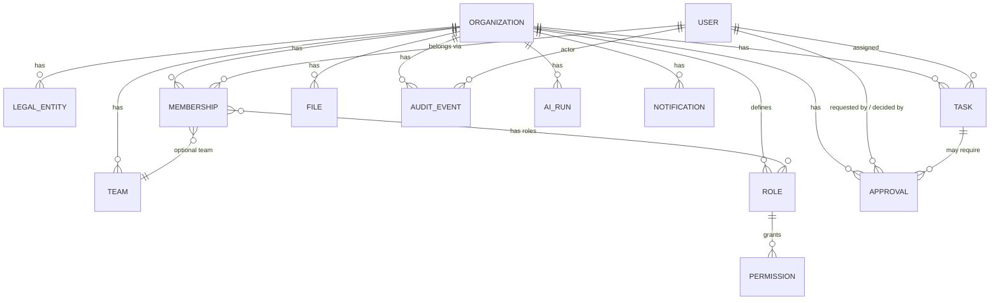

# Domain Model

Full target domain model across all modules is cataloged in the master spec
§50 (Data Model) and §10 (Organization Knowledge Graph). This document
defines the **shared platform primitives** that every module builds on
(spec §80) and marks which are implemented now vs. reserved for later
phases.

## Phase 1 entities (implemented)

- **Organization** — the tenant boundary. Everything tenant-scoped carries
  `organization_id`.
- **LegalEntity** — optional sub-division of an Organization (spec §53); a
  single default legal entity is created per org in Phase 1.
- **User** — a person; global identity, not tenant-scoped by itself.
- **Membership** — join of User ↔ Organization (+ optional Team), carries
  one or more Roles. This is the row RBAC and tenant-resolution both read.
- **Team** — optional grouping of memberships within an org.
- **Role / Permission** — Role is a named bundle of capability strings
  (`sales.leads.view`, `ai.actions.approve`, ... spec §54). Seeded system
  roles match the spec's default role list; organizations may add custom
  roles in a later phase.
- **Task** — cross-module unit of work (spec §44). Phase 1 ships the shared
  primitive; module-specific task types arrive with their modules.
- **Approval** — a pending decision gate tied to a risk-classified action
  (spec §B7, §45). Phase 1 ships the primitive and a generic approve/reject
  flow; module-specific approval triggers arrive with their modules.
- **AuditEvent** — append-only record of security-relevant activity
  (spec §B8, §56). Never updated or deleted by application code.
- **File** — uploaded object metadata; the object bytes live in S3/MinIO,
  referenced by a signed URL, never a raw key exposed as auth.
- **AiRun** — one call through the AI Model Gateway: task type, prompt
  version, model, input classification, output, citations, confidence,
  policy result (spec §F3, §56).
- **Notification** — in-app notification record; email/Slack/Teams dispatch
  channels are interfaces with a local/demo adapter in Phase 1.

## Reserved (not yet modeled — created with their owning phase)

| Domain | Key entities | Phase |
|---|---|---|
| Knowledge | documents, document_chunks, knowledge_bases, entities, entity_relationships | 2 |
| Compliance | frameworks, controls, evidence, risks, policies, audits | 3 |
| AI Governance | ai_systems, ai_assessments, ai_incidents | 3 |
| Privacy | processing_activities, dpias, dsars, data_transfers | 3 |
| Security | security_assets, security_findings, vulnerabilities, security_incidents | 4 |
| Sales | accounts, contacts, leads, sequences, opportunities | 5 |
| Support | customers, tickets, support_conversations, knowledge_articles | 6 |
| Automation | workflows, workflow_versions, workflow_runs | 7 |
| Integrations | integration_connections, webhooks, api_keys | 9 |
| Billing | subscriptions, entitlements | 10 |

## Cross-module entity linking (spec §81)

Reserved-domain entities will carry foreign keys back to Phase 1 primitives
(e.g. a future `sales.accounts` row links to `core.tasks`,
`core.audit_events`, and — once it exists — `support.support_conversations`)
rather than duplicating concepts. This is why Phase 1 ships Organization,
User, Task, Approval, File, AuditEvent, AiRun, Notification first: every
later module depends on them.
