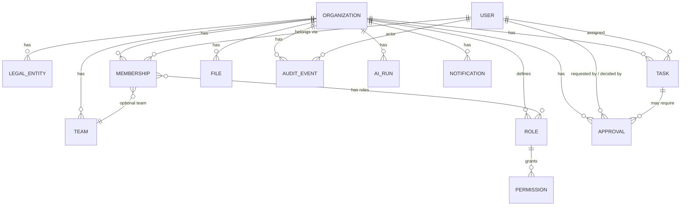
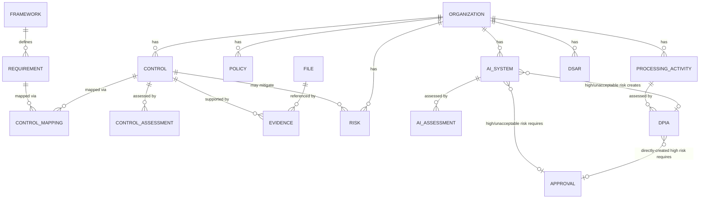
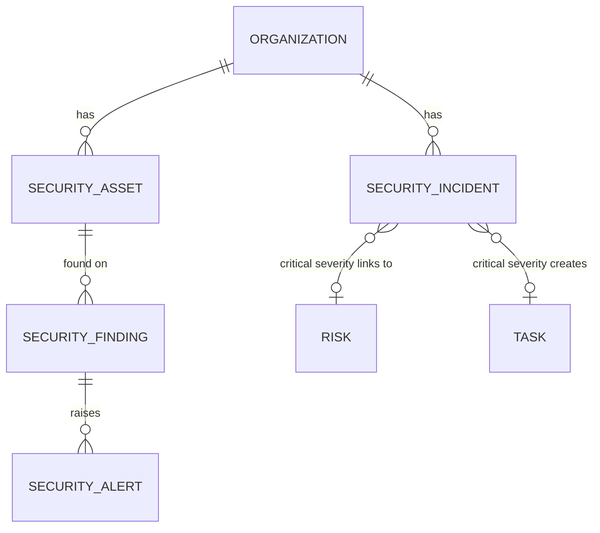
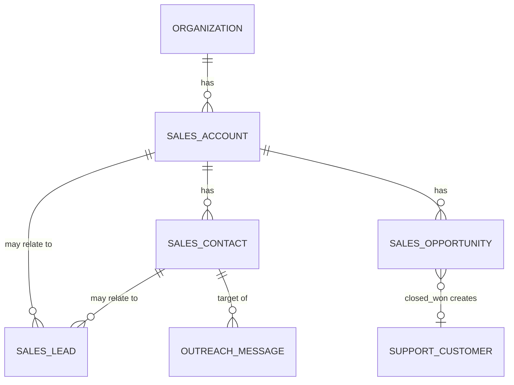
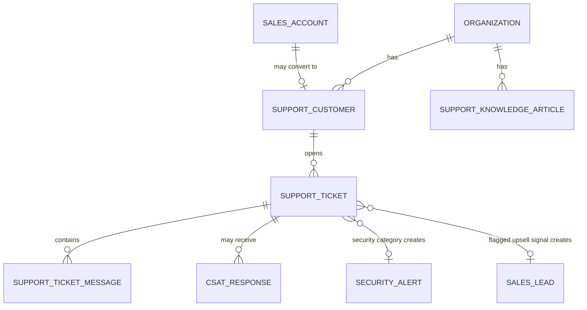
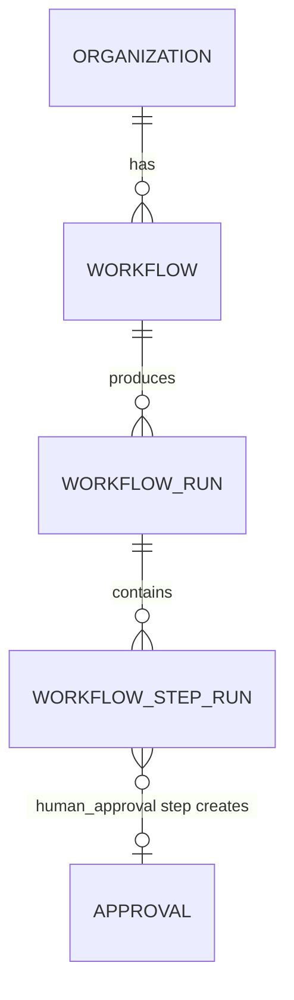
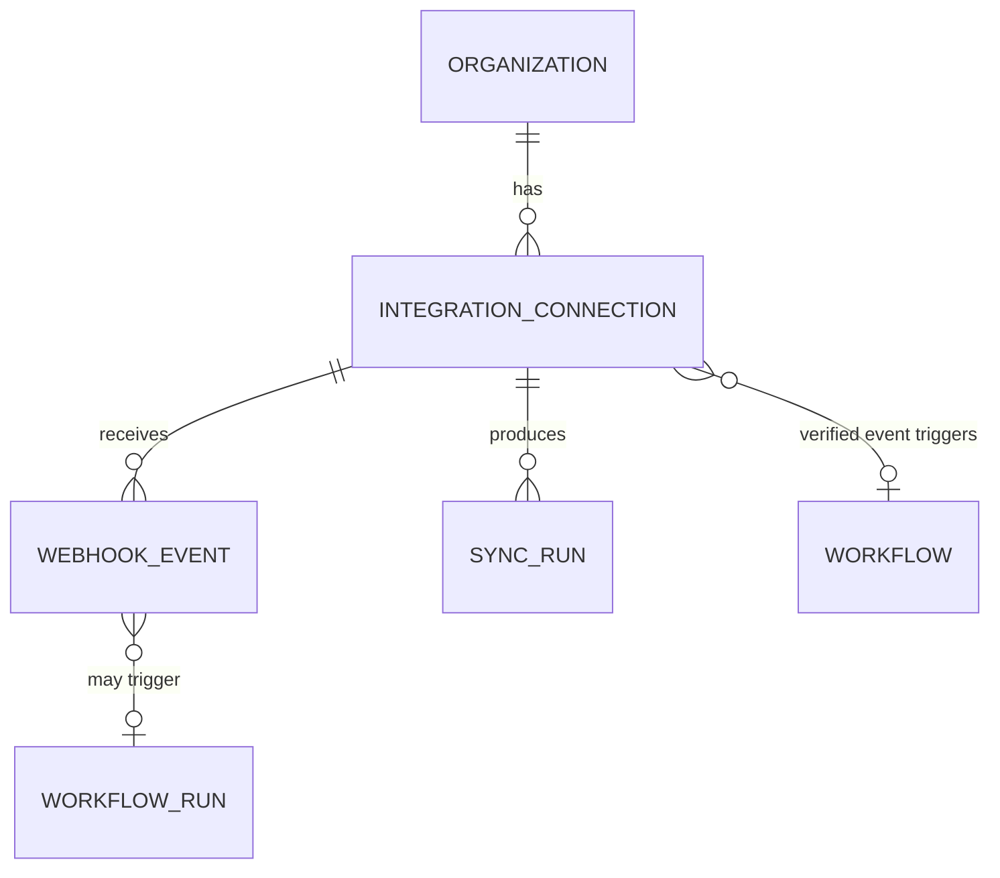

# Domain Model

Full target domain model across all modules is cataloged in the master spec
§50 (Data Model) and §10 (Organization Knowledge Graph). This document
defines the **shared platform primitives** that every module builds on
(spec §80) and marks which are implemented now vs. reserved for later
phases.

## Phase 1 entities (implemented)

- **Organization** — the tenant boundary. Everything tenant-scoped carries
  `organization_id`.
- **LegalEntity** — optional sub-division of an Organization (spec §53); a
  single default legal entity is created per org in Phase 1.
- **User** — a person; global identity, not tenant-scoped by itself.
- **Membership** — join of User ↔ Organization (+ optional Team), carries
  one or more Roles. This is the row RBAC and tenant-resolution both read.
- **Team** — optional grouping of memberships within an org.
- **Role / Permission** — Role is a named bundle of capability strings
  (`sales.leads.view`, `ai.actions.approve`, ... spec §54). Seeded system
  roles match the spec's default role list; organizations may add custom
  roles in a later phase.
- **Task** — cross-module unit of work (spec §44). Phase 1 ships the shared
  primitive; module-specific task types arrive with their modules.
- **Approval** — a pending decision gate tied to a risk-classified action
  (spec §B7, §45). Phase 1 ships the primitive and a generic approve/reject
  flow; module-specific approval triggers arrive with their modules.
- **AuditEvent** — append-only record of security-relevant activity
  (spec §B8, §56). Never updated or deleted by application code.
- **File** — uploaded object metadata; the object bytes live in S3/MinIO,
  referenced by a signed URL, never a raw key exposed as auth.
- **AiRun** — one call through the AI Model Gateway: task type, prompt
  version, model, input classification, output, citations, confidence,
  policy result (spec §F3, §56).
- **Notification** — in-app notification record; email/Slack/Teams dispatch
  channels are interfaces with a local/demo adapter in Phase 1.

## Reserved (not yet modeled — created with their owning phase)

| Domain | Key entities | Phase |
|---|---|---|
| Knowledge | ~~documents, document_chunks, knowledge_bases~~ (implemented — see below), entities, entity_relationships (not yet) | 2 |
| Compliance | ~~frameworks, requirements, controls, evidence, risks, policies~~ (implemented — see below), audits (not yet) | 3 |
| AI Governance | ~~ai_systems, ai_assessments~~ (implemented — see below), ai_incidents (not yet) | 3 |
| Privacy | ~~processing_activities, dpias, dsars~~ (implemented — see below), data_transfers (not yet) | 3 |
| Security | ~~security_assets, security_findings, security_alerts, security_incidents~~ (implemented — see below) | 4 |
| Sales | ~~accounts, contacts, leads, opportunities, outreach_messages~~ (implemented — see below), sequences/campaigns (not yet) | 5 |
| Support | ~~customers, tickets, ticket_messages, knowledge_articles, csat_responses~~ (implemented — see below), support_slas, support_qa_reviews (not yet) | 6 |
| Automation | ~~workflows, workflow_runs, workflow_step_runs~~ (implemented — see below), workflow_versions (not yet) | 7 |
| Integrations | ~~integration_connections, webhook_events~~ (implemented — see below, webhook connector only), api_keys, real OAuth connectors (not yet) | 9 |
| Billing | subscriptions, entitlements | 10 |

## Phase 2 entities (implemented)

- **KnowledgeBase** — a named collection of documents per organization. A
  "General" one is created lazily the first time a document is uploaded
  without specifying which knowledge base it belongs to.
- **Document** — one uploaded `File` registered for ingestion. Status
  moves `pending → processing → ready` or `failed`/`unsupported_format`
  (spec §I4: honest states, never a fabricated "ready").
- **DocumentChunk** — one chunk of extracted text plus its embedding
  vector (stored as JSON — see `docs/DECISIONS.md` ADR-0007) and token
  count. This is the substrate the AI Copilot's RAG retrieval (not yet
  built) will query against.

Entity/relationship extraction (spec §11's knowledge graph) is not
implemented — chunks are stored flat, with no entity linking yet.
Retrieval and the AI Copilot (Phase 2's remaining scope at the time the
note above was written) are now implemented — see `docs/AI_ARCHITECTURE.md`.

## Phase 3 entities (implemented — Compliance backbone)

- **Framework / Requirement** — global catalog data (GDPR, EU AI Act, ISO
  27001 seeded; NIS2/DORA/SOC 2/custom frameworks follow the same pattern
  when needed), not tenant-scoped — regulatory text doesn't vary per
  organization, same reasoning as system Roles.
- **Control** — an organization's own implemented measure, optionally
  mapped to one or more catalog Requirements via **ControlMapping**.
- **ControlAssessment** — a point-in-time pass/fail/partial judgement. A
  `fail` assessment automatically creates a `core.Task` (spec §80's
  "shared primitives" principle in action, not a Compliance-specific
  follow-up mechanism).
- **Evidence** — reuses the Phase 1 **File** primitive rather than a
  parallel storage path; optionally attached to a Control.
- **Risk / Policy** — organization-scoped; a Risk may reference the
  Control that mitigates it.
- **AISystem / AIAssessment** — the AI System Inventory (spec §12/§55, EU
  AI Act governance), added alongside Phase 8's cross-module work rather
  than as a standalone Phase 3 follow-up. `risk_classification` uses the
  EU AI Act's own four tiers (minimal/limited/high/unacceptable) rather
  than a parallel scale. Registering a `high` or `unacceptable` system
  automatically creates a real Phase 1 **Approval** and links it via
  `AISystem.approval_id` (`app/compliance/service.py::register_ai_system`,
  ADR-0027) — the same "shared primitives" hook pattern as the
  `ControlAssessment`→Task hook below, and this build's third use of
  Approval outside its own generic UI (after Automation's
  `human_approval` step and this same feature's gate). AIAssessment is a
  lightweight point-in-time record (pass/fail/partial/not_assessed),
  deliberately not reusing ControlAssessment — an AI system isn't a
  Control, and forcing the reuse would mean adding AI-specific columns to
  a Compliance-control-shaped table.
- **ProcessingActivity / DPIA / DSAR** — spec §2/§12's Privacy
  sub-features (RoPA, DPIA, DSAR — a Compliance capability, not a
  separate primary module; see the spec's own module list). ProcessingActivity
  is the organization's own RoPA entry (GDPR Article 30), tenant-scoped
  like Control rather than global like Framework. A `DPIA` may link to a
  ProcessingActivity, an AISystem, or neither; a directly-created
  `risk_level="high"` DPIA gets its own real Approval, gated exactly like
  AISystem (this build's fourth reuse of Approval outside its own UI).
  `register_ai_system` is extended a **second** time (ADR-0029): a
  high/unacceptable-risk registration now also creates a linked draft
  DPIA via `DPIA.ai_system_id` — spec §69 "New AI Tool Adoption"'s
  "Privacy assessment" step — sharing the AISystem's existing Approval
  rather than creating a redundant second one. DSAR gets
  `due_at = created_at + 30 days` (GDPR Article 12(3)) and a
  received→in_progress→fulfilled/rejected lifecycle.

Not modeled yet: framework/evidence versioning, audits (auditor portal),
ai_incidents, data transfers (the remaining Privacy sub-feature), vendor
risk, questionnaires, Trust Center — each a substantial feature attaching
to this backbone, not blocking it. See `docs/KNOWN_LIMITATIONS.md`.

## Phase 4 entities (implemented — Security backbone)

- **SecurityAsset** — cloud accounts, servers, endpoints, repositories,
  etc. (spec §14's inventory). Tenant-scoped, unlike Compliance's
  Framework/Requirement — an organization's own infrastructure, not
  shared catalog data.
- **SecurityFinding** — consolidates the spec's parallel
  vulnerabilities/cloud_findings/identity_findings into one table with a
  `category` discriminator (`docs/DECISIONS.md` ADR-0017); optionally
  tied to a SecurityAsset.
- **SecurityAlert** — the triage inbox (spec §18); optionally tied to the
  SecurityFinding that raised it.
- **SecurityIncident** — the escalated workspace (spec §19). A
  `critical`-severity incident automatically creates and links a
  Compliance **Risk** (ADR-0018) — the explicit security↔compliance
  connection spec §19 calls "critical," implemented the same way Phase
  3's failed-assessment→Task hook was (shared primitives, not a new
  module-specific type). The same call also creates a response **Task**
  and notifies the incident's owner if one is set (Phase 8, ADR-0023) —
  the rest of spec §69's "Security Incident" chain, extending this one
  hook rather than adding a second.

Not modeled yet: identity-provider integrations (Okta/Entra/Google
Workspace — spec §16), cloud-provider connectors (spec §15), incident
playbooks/timeline/evidence sub-objects (spec §19 lists these as part of
the incident workspace), vulnerability scanner ingestion. The
`SecurityFinding.category` field anticipates these without modeling their
ingestion pipelines yet.

## Phase 5 entities (implemented — Sales backbone)

- **Account / Contact** — an organization's own CRM data (tenant-scoped,
  unlike Compliance's catalog). `Contact.do_not_contact` is the
  suppression flag the cross-module hook checks.
- **Lead** — loosely linked to an Account/Contact (both nullable — a lead
  may arrive before either exists).
- **Opportunity** — belongs to exactly one Account; moves through a
  pipeline stage enum. `onboarding_customer_id` is the Phase 8 "New
  Customer" cross-module hook: the first `closed_won` transition creates
  a real Support **Customer** and an onboarding **Task** (spec §69,
  ADR-0025) — see the Phase 8 section below.
- **OutreachMessage** — a draft/sent/blocked record. `send_outreach_message`
  (`app/sales/service.py`) refuses to mark a message `sent` if the target
  Contact is suppressed, setting it `blocked` instead (spec §91, ADR-0019)
  — the explicit "Compliance governs Sales" connection, implemented as a
  real, tested check rather than an aspiration.

Not modeled yet: sequences/campaigns (multi-step outreach automation —
spec §25), lead scoring beyond a raw numeric field, meetings, sales
conversations/inbox, pipeline events, playbooks. Real lead-finding,
enrichment, and message sending all depend on external connectors that
don't exist yet (spec's progressive trust model, §B1).

## Phase 6 entities (implemented — Customer Support backbone)

- **Customer** — an organization's own support account; `sales_account_id`
  optionally links back to the Sales **Account** it converted from (spec
  §69 "New Customer" cross-module scenario), nullable because not every
  Support Customer originated in Sales.
- **Ticket** — consolidates the spec's separate `support_conversations`
  concept into one row (a conversation *is* a ticket here) and its
  `support_intents` into `Ticket.category`, mirroring the Security
  findings consolidation (ADR-0017). `Ticket.related_alert_id` is the
  Phase 6 cross-module hook: a ticket categorized `security` auto-creates a
  **SecurityAlert** and escalates the ticket to `urgent` priority (spec
  §35, ADR-0020) — Security's own triage inbox, not a full Incident; a
  human security analyst decides whether to promote it further, the same
  workflow Security already uses for its own findings. `Ticket.upsell_lead_id`
  is the Phase 8 cross-module hook: flagging a ticket creates a real Sales
  **Lead** and notifies the linked account's owner (spec §69 "Support
  Upsell Signal", ADR-0022) — see the Phase 8 section below.
- **TicketMessage** — one message in the ticket thread, tagged
  `customer`/`agent`/`ai`.
- **KnowledgeArticle** — organization-scoped support content;
  `published` gates customer/AI visibility (not yet enforced by any
  reader — no AI drafting flow consumes it yet, see
  `docs/KNOWN_LIMITATIONS.md`).
- **CSATResponse** — a 1-5 score plus optional comment, tied to a ticket.

Not modeled yet: SLA policies/timers (`support_slas`), QA review scoring
(`support_qa_reviews`), multi-channel ingestion (only `email`/`chat`/`api`
exist as a channel tag, no actual channel connector), AI-drafted replies
or confidence-gated auto-resolution (spec §32 — the Copilot/retrieval
infrastructure from Phase 2 could support this, but nothing wires Support
into it yet), knowledge-gap detection, FAQ generation.

## Phase 7 entities (implemented — Business Automation backbone)

- **Workflow** — `steps` is a JSON-defined ordered list
  (`{step_type, config}`), not a visual builder yet (spec §37's much
  larger step vocabulary — Condition/Delay/Loop/Data Transform/Webhook/
  Subworkflow/AI Step — is out of scope for this slice, see
  `docs/KNOWN_LIMITATIONS.md`). `status` follows spec §41's governance
  states (draft/testing/active/paused/archived); steps can only be
  edited via a dedicated endpoint while `status = draft` — publishing
  locks them, so an edit can never silently change already-active
  behavior.
- **WorkflowRun** — one execution, `status`
  running/succeeded/failed/awaiting_approval. `trigger_type` is `manual`
  only — every other spec §38 trigger (new email, webhook, CRM stage
  change, ...) needs external connectors that don't exist yet.
- **WorkflowStepRun** — one step's execution record, making a run's
  history inspectable (spec §41 "workflow logs"), not just a final
  pass/fail. `approval_id` is the cross-module hook: a `human_approval`
  step creates a real Phase 1 **Approval** and pauses the run until it's
  decided through the existing `/api/v1/approvals/{id}/decide` endpoint
  (ADR-0021) — the first domain module to actually exercise that
  primitive outside its own generic UI.

Not modeled yet: workflow templates, AI steps (spec §40 — generate/
summarize/classify/extract/RAG query), data transforms, branching/loops,
webhooks and other non-manual triggers, retries/failure policies beyond
"step failed → run failed," automation analytics (spec §43). Real
non-manual triggers (new email, CRM stage change, webhook) depend on the
connector SDK (Phase 9).

## Phase 8 (Cross-Module Intelligence — three slices: Support Upsell Signal, Security Incident chain, New Customer)

Spec §69 names five cross-module scenarios; this build implements three
as real, tested verticals rather than stubbing all five (spec §80/§82's
"one real vertical, not everything" discipline, applied again).

"Support Upsell Signal": a support agent flags a ticket, which
(`app/support/service.py::flag_upsell_signal`) creates a `sales.Lead`
(`source = "support_upsell_signal"`, linked to the ticket's Customer's
Sales Account if one exists) and a `core.Notification` to that account's
owner — three primitives that already existed (Ticket, Lead,
Notification), not a new `sales_signal` entity (ADR-0022). Only
`Ticket.upsell_lead_id` was added.

"Security Incident" chain: the Incident→Risk link already existed from
Phase 4 (ADR-0018); this slice extends the same
`app/secops/service.py::create_incident` call so a `critical`-severity
incident also creates a `core.Task` (the "creates incident response
tasks" step) and, if the incident has an owner, a `core.Notification`
(the "notifies responsible team" step) — completing the chain spec §69
describes, still gated on the same severity check, still one function
(ADR-0023). Only `SecurityIncident.related_task_id` was added.

"New Customer": `app/sales/service.py::close_opportunity_won` fires the
first time a Sales `Opportunity` transitions to `closed_won`. It creates
a real Support `Customer` (using the account's earliest Contact for the
required email) and a `core.Task` due in 7 days — spec §69's "create
customer / create support profile" and "provision internal tasks /
schedule check-in" steps collapsed into two existing primitives rather
than nine new ones (ADR-0025). `Opportunity.onboarding_customer_id` is
both the link and the idempotency guard — a later closed_won transition
on the same opportunity is a no-op. If the account has no Contact yet,
the stage change still succeeds but onboarding is honestly skipped
(`sales.opportunity.onboarding_skipped`) rather than fabricating a
customer with no real email.

Not modeled yet, and deliberately deferred rather than attempted
speculatively: "Enterprise Sales Security Review" (needs customer
questionnaires, which don't exist), an AI daily briefing, business
process discovery, an AI recommendation engine, and organization memory —
all large, open-ended features with no existing primitive to hang them
off of, unlike the scenarios chosen here. "New Customer" also
doesn't yet send a real welcome email or update a billing/accounting
system — no email provider or accounting connector exists (spec §48).
"New AI Tool Adoption" now has two real steps — the AI System
Inventory's register→gate→approve hook (see the Phase 3 section above,
ADR-0027) and, as of the Privacy slice, an auto-created DPIA covering the
chain's "Privacy assessment" step (ADR-0029) — but the rest of spec §69's
chain (vendor security questionnaire, EU AI Act applicability/DPA review
as distinct sub-steps, approved-use policy publication) is still not
implemented; see `docs/KNOWN_LIMITATIONS.md`.

## Phase 9 entities (implemented — Integrations backbone: Webhook + six-provider OAuth2 framework)

- **IntegrationConnection** — two connector shapes. `connector_key="webhook"`
  (ADR-0024): `webhook_secret` is the connection's own auth mechanism
  (HMAC-SHA256), not a platform session; `linked_workflow_id` is the
  cross-module hook — pointing it at an `active` Automation workflow with
  `trigger_type="webhook"` means a verified inbound event triggers that
  workflow via `app.automation.service.start_run`.
  connector_keys `hubspot`/`google`/`microsoft`/`github`/`slack`/
  `salesforce` (ADR-0026, ADR-0028): a real OAuth2 authorization-code
  flow via `app.integrations.adapters.{provider}.{Provider}Adapter`,
  selected only when that provider's `*_CLIENT_ID`/`*_CLIENT_SECRET` are
  configured — otherwise `MockOAuthAdapter` (same role as the AI
  gateway's `DemoAdapter`), labeled with the real `provider_key` so a
  mocked Google connection never looks like a mocked Slack one.
  `encrypted_access_token`/`encrypted_refresh_token` are Fernet-encrypted
  at rest; `oauth_state` is the flow's own single-use CSRF token, since
  the callback route has no session to rely on. `scopes`,
  `external_account_id`, and `health_status` make the connection's real
  state (not a fabricated "connected" badge) visible, and the provider
  catalog additionally exposes each provider's requested `scopes` as a
  permission preview before a connection even exists.
- **WebhookEvent** — an audit trail of every inbound call, `verified`
  true or false, whether or not it triggered anything — spec §49's
  "Connections must store... Last sync, Last error" at per-event
  granularity, not just a rolled-up connection-level status.
- **SyncRun** — one "sync now" execution against an OAuth connection
  (spec §49's `sync()`), created synchronously (`status="running"`) and
  finalized by `IntegrationSyncWorkflow` (`apps/worker`) — a durable
  Temporal job, not inline in the request, the same request/durable-
  execution split Knowledge's `DocumentIngestionWorkflow` uses.

Not modeled yet: any OAuth connector beyond these six (Email, Marketing,
Customer Support beyond generic webhook, Cloud, remaining Identity/
Engineering/Communication/Documents/Accounting categories — spec §48;
each needs its own real provider credentials),
`subscribe()`/`execute_action()`/`collect_evidence()` from spec §49's
full Connector Contract (this slice only needed authorize, token
exchange/refresh, health, sync, and revoke), sync safety features
(incremental cursors, checkpointing, replay safety — spec §G2), API keys
for outbound platform access.

## Cross-module entity linking (spec §81)

Reserved-domain entities will carry foreign keys back to Phase 1 primitives
(e.g. a future `sales.accounts` row links to `core.tasks`,
`core.audit_events`, and — once it exists — `support.support_conversations`)
rather than duplicating concepts. This is why Phase 1 ships Organization,
User, Task, Approval, File, AuditEvent, AiRun, Notification first: every
later module depends on them.
