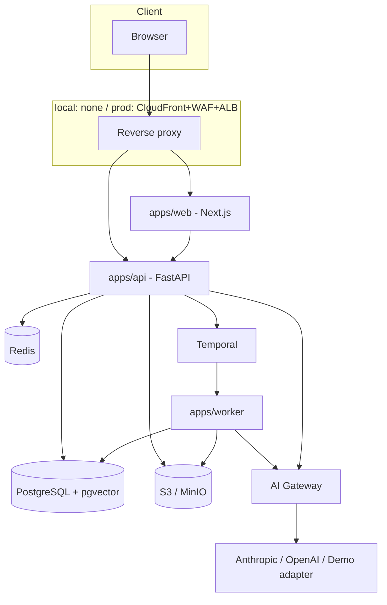

# Platform Architecture

## Style: modular monolith

One backend service (`apps/api`), one background worker service
(`apps/worker`), one frontend (`apps/web`), sharing a single PostgreSQL
database with strong per-domain schema boundaries. No microservices until a
concrete scaling or team-ownership reason forces the split (spec §D2, §98).



## Monorepo layout

```text
apps/
  web/           Next.js 15 App Router, TypeScript strict
  api/           FastAPI, Pydantic v2, SQLAlchemy 2, Alembic
  worker/        Temporal Python worker(s)
packages/
  ui/            shared shadcn/ui component library (TS)
  types/         shared TS types (generated from OpenAPI where practical)
  sdk/           generated TS client for apps/api
infra/
  docker/        docker-compose.yml + Dockerfiles
  terraform/     AWS IaC (added in a later phase, see IMPLEMENTATION_STATUS)
  scripts/       dev/setup/seed helper scripts
docs/
  adrs/          architecture decision records
  *.md           architecture docs (this family of files)
```

`packages/ai-core`, `packages/automation-core`, `packages/compliance-models`,
`packages/integration-sdk` from the spec's monorepo list (spec §52) are
introduced when Phase 2+ needs them — creating them empty now would just be
unused scaffolding (see [`DECISIONS.md`](DECISIONS.md) ADR-0002).

## Backend domain boundaries (Python packages under `apps/api/app`)

Mirrors spec §D2. Each is a Python package with its own models, service
layer, and router; cross-domain calls go through service functions, not raw
ORM queries reaching into another domain's tables.

```text
core            organizations, legal_entities, users, teams, memberships,
                roles, permissions, tasks, approvals, notifications, files,
                activity/audit log
identity        auth: signup, login, session, MFA, password reset, invites
authorization   RBAC engine, tenant-context resolution, policy checks
audit           append-only audit event writer + query API
ai              model gateway (generate/generate_structured/embed/rerank/
                stream), provider adapters, AI run/action logging
knowledge       documents, chunks, knowledge bases, sources (Phase 2)
compliance      frameworks/controls/evidence/... (Phase 3)
security        assets/findings/incidents/... (Phase 4)
sales           accounts/leads/sequences/... (Phase 5)
support         tickets/conversations/... (Phase 6)
automation      workflow engine integration, triggers/actions (Phase 7)
integrations    connector SDK + connections (Phase 9)
billing         plans/entitlements (Phase 10)
reporting       cross-module reports (Phase 8+)
notifications   in-app/email/Slack/Teams dispatch
```

Only `core`, `identity`, `authorization`, `audit`, `ai` (gateway + demo
adapter) exist as of Phase 1. All others are directories reserved by this
document, not yet code.

## Tenant isolation (spec §E5, §53)

- Every tenant-scoped table has a non-nullable `organization_id` foreign key.
- The API never trusts a client-supplied `organization_id`. A request
  authenticates to a `User`, then resolves an `active_organization_id` from
  the user's session/membership — see
  [`SECURITY_ARCHITECTURE.md`](SECURITY_ARCHITECTURE.md#tenant-resolution).
  Middleware attaches this resolved id to request state; all repository/query
  helpers require it as an explicit parameter (never optional), so a query
  missing tenant scoping fails to compile/type-check rather than silently
  leaking.
- Automated tenant-isolation tests are mandatory per domain (spec §E5) —
  see `apps/api/tests/test_tenant_isolation.py`.

## Environments

`local` (Docker Compose) → `development` → `staging` → `production` (AWS).
AWS topology is specified in the master spec §L/§M/§N and will be
implemented in a later phase — see [`IMPLEMENTATION_STATUS.md`](IMPLEMENTATION_STATUS.md).

## Related documents

- [`DOMAIN_MODEL.md`](DOMAIN_MODEL.md) — entities and relationships
- [`DATABASE_MODEL.md`](DATABASE_MODEL.md) — table-level schema for Phase 1
- [`AI_ARCHITECTURE.md`](AI_ARCHITECTURE.md) — model gateway, governance, RAG
- [`SECURITY_ARCHITECTURE.md`](SECURITY_ARCHITECTURE.md) — auth, RBAC, tenant
  isolation, trust model
- [`ROUTES_AND_SCREENS.md`](ROUTES_AND_SCREENS.md) — frontend route map
- [`IMPLEMENTATION_PLAN.md`](IMPLEMENTATION_PLAN.md) — phased delivery order
