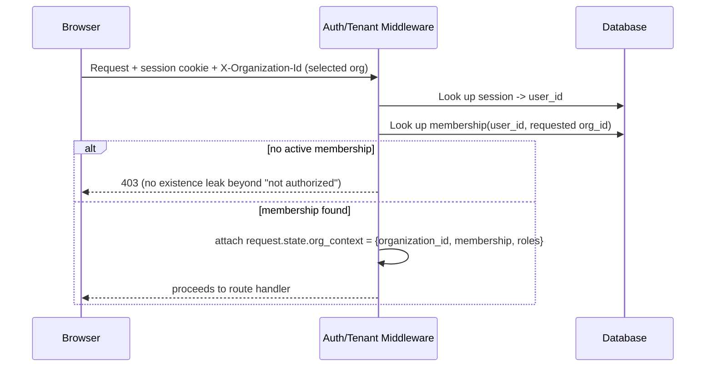

# Security Architecture (Phase 1 scope)

Full release baseline is spec §H; this document covers what Phase 1
implements and how, plus the trust model from spec §B.

## Authentication (spec §E4)

First-party implementation (no coupling to a single SaaS auth vendor):

- Email + password, hashed with `argon2` (via `passlib`).
- Session-based auth: opaque random session token, stored **hashed**
  (`sha256`) in `sessions.session_token_hash`; the raw token is set as an
  `HttpOnly`, `Secure`, `SameSite=Lax` cookie. No JWTs for session state in
  Phase 1 — sessions must be server-revocable (spec §E4 "session revocation"),
  which a self-contained JWT cannot do without an additional revocation-list
  layer that duplicates the sessions table anyway (ADR-0001).
- Email verification and password reset use single-use, expiring, hashed
  tokens (same pattern as sessions).
- MFA/TOTP: `mfa_enabled` + encrypted `mfa_secret` columns exist in Phase 1
  schema; enforcement UI/flow ships once auth screens are built (tracked in
  IMPLEMENTATION_STATUS, not silently skipped).
- Invitations: a membership row with `status = 'invited'` plus a signed,
  expiring invite token.

## Tenant resolution (spec §E5)

- The `organization_id` used for every DB query in a request comes from
  `request.state.org_context`, resolved server-side from the session +
  membership table — **never** taken at face value from a client-supplied
  body/query field.
- Repository functions take `organization_id` as a required first argument;
  there is no "unscoped" query helper in the codebase for tenant tables.

## RBAC (spec §54)

- Roles are bundles of permission keys (`sales.leads.view`, dot-namespaced by
  module). Phase 1 seeds the system roles from the spec's default list
  (Organization Admin, Executive, Operations Manager, Compliance Manager,
  DPO, Security Manager, AI Governance Manager, Sales Manager, Sales
  Representative, Support Manager, Support Agent, Automation Manager, Legal,
  Auditor, Employee, Read Only) with a minimal Phase-1-relevant permission
  set (`core.*`, `org.*`); module-specific permissions are added when each
  module ships.
- Enforcement is a FastAPI dependency, `require_permission("key")`, checked
  server-side on every mutating route. The frontend may hide UI for
  permissions a user lacks, but that is UX only — never the authorization
  boundary.

## Progressive trust model (spec §B1–B3) — status

Stage 0 (no integration: manual org setup, sample data) is possible once
onboarding ships (tracked separately). Stages 1–4 depend on the Integrations
module (Phase 9) and are out of scope for Phase 1; this document exists so
the connector work, when it starts, follows the stage model rather than
reinventing it.

## Audit logging (spec §B8)

- `audit_events` is append-only **at the application layer today**: no
  service function ever issues `UPDATE`/`DELETE` against `AuditEvent`, and
  code review / the test suite are the only things enforcing that. A real
  DB-level `REVOKE UPDATE, DELETE` requires the application to connect as a
  role that does **not** own the table (Postgres table owners bypass grant
  checks on their own tables) — Phase 1's local Docker Compose Postgres uses
  a single `agora` role for both migrations and the app, so that separation
  doesn't exist yet. It is planned for the AWS phase, which already calls
  for "separate database roles for application, migrations, and read-only
  operational access" (spec §L3). Tracked in `KNOWN_LIMITATIONS.md`.
- Every state-changing request handler writes one audit event with actor,
  organization, action, object, before/after summary (where meaningful),
  policy decision, correlation id (propagated from the `X-Request-Id`
  header or generated), and timestamp.

## Data protection defaults (spec §B9)

- TLS termination at the edge (local dev: plain HTTP is acceptable, see
  `KNOWN_LIMITATIONS.md`).
- Secrets never logged; the environment validation module
  (`apps/api/app/config.py`) reports **which variables** are missing at
  startup, never their values.
- Signed, short-lived URLs for file downloads (S3/MinIO presigned URLs),
  never a raw storage key used as an authorization token.

## Deferred to later phases (documented, not silently dropped)

CSRF/CSP/rate limiting/SSRF controls apply once there are state-changing
browser-originated forms and outbound-fetching features to protect; MFA
enforcement UI, SSO/SAML/SCIM, and the full connector permission-preview UX
are explicitly out of Phase 1. See `KNOWN_LIMITATIONS.md`.
